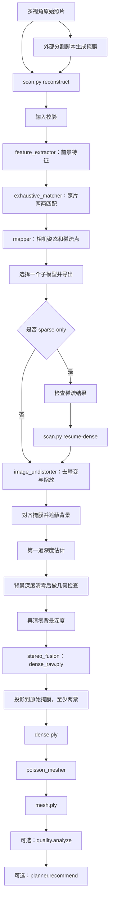

# scanner 模块说明：从图片集到三维网格

本文按当前项目实际代码说明 `scanner/` 下各文件、各函数的职责，以及从照片到网格的完整调用流程。文中区分已实现的行为与现有限制，不把程序执行成功等同于模型质量合格。

## 1. 模块结构

```text
final/
├── scan.py                  命令行入口
├── scanner/
│   ├── __init__.py          包说明
│   ├── reconstruct.py       调用 COLMAP，完成照片重建
│   ├── dense_masks.py       对齐稠密掩膜、遮蔽图片并清零背景深度
│   ├── io.py                JSON、PLY 文件读写
│   ├── geometry.py          投影、射线、可见性和转台变换
│   ├── quality.py           分析网格的点云支持与观察覆盖
│   ├── planner.py           根据质量报告推荐补拍姿态
│   └── demo.py              生成合成演示数据
└── tools/                   分割、黑底图片导出、预览等辅助脚本
```

Python 主要负责参数、文件、调用顺序和后处理。SIFT 特征、照片匹配、SfM、稠密深度、深度融合和 Poisson 网格生成主要由外部 COLMAP 程序完成。

## 2. 数据与坐标约定

| 数据 | 含义 |
| --- | --- |
| `vertices` / `points` | `N×3` 三维坐标 |
| `faces` | `M×3` 三角面顶点索引 |
| `colors` | `N×3` RGB 颜色 |
| `normals` | `N×3` 表面法线 |
| `K` | 相机内参矩阵，包含焦距和主点 |
| `R`, `t` | 世界坐标到相机坐标的旋转和平移 |
| `distortion` | 镜头畸变参数 |
| `mask` | 与原图同尺寸的前景掩膜；零为背景，非零为前景 |

代码中的坐标关系为：

```text
相机坐标 Xc = R × Xw + t
相机中心 C  = -Rᵀ × t
```

理想针孔投影可写为 `u = fx·Xc/Zc + cx`、`v = fy·Yc/Zc + cy`。实际投影还通过 OpenCV 处理畸变。

SfM 输出是任意尺度的物体坐标系，没有标定时不能直接把坐标解释为毫米。`read_model()` 构造的 `K` 对 COLMAP 主点使用了减 `0.5` 的像素坐标转换，供后续 OpenCV 投影使用。

## 3. reconstruct.py：照片重建

### 3.1 `quaternion_matrix(q)`

**用途：** 将 COLMAP 的旋转四元数转换成 `3×3` 旋转矩阵。

- 输入：按 `[w, x, y, z]` 排列的四元数。
- 处理：先归一化，再按四元数公式计算矩阵。
- 返回：旋转矩阵 `R`。
- 调用者：`read_model()`。

### 3.2 `read_model(folder)`

**用途：** 将 COLMAP 文本模型转换成 Python 相机列表。

读取：

```text
folder/cameras.txt    相机内参、尺寸和畸变
folder/images.txt     各张照片的旋转、平移和名称
```

支持的相机模型是 `SIMPLE_PINHOLE`、`SIMPLE_RADIAL`、`RADIAL`、`PINHOLE`、`OPENCV`、`FULL_OPENCV`。其他模型会报错。

步骤：

1. 解析每个相机 ID 对应的内参。
2. 解析每张照片使用的相机 ID。
3. 调用 `quaternion_matrix()` 得到 `R`。
4. 读取 `t` 并计算相机中心。
5. 跳过每张照片后的二维观测记录行，继续读取下一张照片。

返回列表，每个元素包含 `file`、`K`、`distortion`、`size`、`model`、`R`、`t`、`center`。它不读取稀疏点坐标。

### 3.3 `reconstruct(...)`

**用途：** 从输入照片开始，组织整套重建。

| 参数 | 含义与默认值 |
| --- | --- |
| `images` | 输入照片目录 |
| `output` | 输出目录 |
| `executable` | COLMAP 路径，默认 `colmap` |
| `masks` | 掩膜目录，默认无 |
| `static` | 是否声明为静止场景，默认 `False` |
| `sparse_only` | 是否只做稀疏重建，默认 `False` |
| `high_detail` | 是否启用更细的特征配置，默认 `False` |
| `patch_window_radius` | 稠密匹配半径，默认 `5` |
| `camera_params` | 可选内参初值，格式 `f,cx,cy,k` |

执行顺序：

1. 递归收集 JPG、JPEG、PNG、BMP、TIF、TIFF，至少需要 3 张。
2. 旋转物体默认必须提供掩膜；`static=True` 允许无掩膜的静止场景。
3. 检查掩膜文件存在、与原图同尺寸且非空。
4. 查找 COLMAP，创建输出目录、日志和数据库路径。
5. 调用 `feature_extractor` 提取特征。
6. 调用 `exhaustive_matcher` 两两匹配。
7. 调用 `mapper` 计算相机姿态和稀疏结构。
8. 查找生成的子模型，选择 `images.bin` 文件最大的一个。
9. 用 `model_converter` 导出文本模型、`cameras.json` 和 `sparse.ply`。
10. 保存稀疏统计与未完成稠密重建的状态。
11. 若 `sparse_only=True`，返回相机列表；否则调用 `_finish_dense()`。

**掩膜命名：** 在图片相对路径后追加 `.png`。例如 `a/001.jpg` 对应 `masks/a/001.jpg.png`。输入若是 `001.jpg.png`，对应掩膜名就是 `001.jpg.png.png`。

**特征配置：** 使用 `SIMPLE_RADIAL` 相机模型，同一文件夹共享相机内参。默认特征提取和匹配使用 CPU；`high_detail=True` 时两者使用 GPU，并设置提取最大边 4096、最多 32768 个特征、峰值阈值 0.0015，以及引导匹配。这些设置不会让稠密图像分辨率变成 4096。

**内参初值：** `camera_params` 要求四个有限数值且焦距为正。它是初始化，不是锁定内参；后续 SfM 仍可能优化焦距和畸变。

**统计含义：** `mean_point_reprojection_error_px` 是 COLMAP 各三维点重投影误差的算术平均，不是全部观测的合并 RMSE，也不是物体尺寸精度。

**内部函数 `run(command, arguments)`：** 拼接 COLMAP 命令，记录到 `logs/commands.json`，将标准输出与错误写入对应日志，检查退出码。

**内部函数 `supported(command, modern, legacy)`：** 读取 COLMAP 帮助，选择当前版本支持的新或旧参数名。

**限制：** 不自动合并多个子模型；不会判断分割是否切错；输出目录已含 `database.db` 时拒绝重新开始，避免混用结果。

### 3.4 `resume_dense(...)`

**用途：** 从已有稀疏模型继续计算深度和网格。

读取 `reconstruction_status.json` 中的 `chosen_model` 和 `cameras.json`，检查模型存在、相机非空、稠密阶段尚未完成，然后调用 `_finish_dense()`。

若稀疏阶段使用了掩膜，续跑时要求传入相同的掩膜路径。这里核对的是路径，不是文件内容哈希；修改同一路径下的掩膜不会被这项检查发现。

内部也有一个 `run()`，负责追加命令历史、执行 COLMAP、检查返回码。对应命令的日志以写入模式打开，续跑时可能覆盖原来的同名日志。

**注意：** 续跑应使用相同图片和参数。新的稠密前景模块检查掩膜内容哈希、原始/稠密相机内参、畸变和窗口半径；拒绝无配置的旧深度缓存，以及配置不同的缓存。它仍未对全部原图内容做哈希验证，改输入图片或做参数对比应使用新目录。

### 3.5 `_finish_dense(...)`

**用途：** 将相机姿态和照片转换为融合点云。

依次调用：

```text
image_undistorter → 对齐掩膜/遮蔽背景 → photometric → 背景深度清零
→ geometric → 背景深度清零 → stereo_fusion → _export_surface
```

- `image_undistorter`：读取输入照片和稀疏模型，去畸变，最大边缩放到 1600。
- `patch_match_stereo`：先显式执行 `geom_consistency=false` 的第一遍，将背景深度清零后，再执行 `geom_consistency=true`，复用第一遍图做几何检查。几何深度在融合前再次按掩膜清零。
- `stereo_fusion`：使用 `geometric` 深度，将多视角一致的深度合成为 `dense_raw.ply`。

匹配窗口边长为 `2 × radius + 1`：半径 5 是 11×11，半径 10 是 21×21。扩大窗口增加参与比较的邻域，也可能跨越物体边缘或平滑细节，不保证一定更好。

**提供掩膜时，当前实现会遮蔽稠密图片背景，并在两遍深度之间和融合前清零背景深度。** 掩膜先使用原相机畸变及去畸变相机内参做坐标映射，采用最近邻采样，图像外视为背景。输入照片保持不动，工作区原始去畸变图片备份在 `dense/images_unmasked`。

本机 PatchMatch 没有原生前景 ROI 参数，仍在全图网格上运算；代码保证被标为背景的深度不作为有效深度进入后续融合，不保证轮廓附近的前景匹配一定正确。无掩膜的静止场景保留原来的全图流程。

### 3.6 `_export_surface(...)`

**用途：** 对融合点云做前景过滤，然后生成网格。

1. 读取 `dense_raw.ply` 的坐标、颜色和法线；没有法线时报错。
2. 遍历相机，将三维点投影到原始照片坐标。
3. 检查点在相机前方、投影在图内、投影处掩膜非零。
4. 每通过一个相机加一票，保留 `votes >= 2` 的点。
5. 至少保留 16 个点，写出 `dense.ply`。
6. 若 `mesh=False`，到此返回；默认继续生成网格。
7. 调用 `poisson_mesher` 生成 `mesh.ply`。
8. 如果网格无面，或顶点数少于 `max(3, 点数×1%)`，改用深度 10、trim 5 重试；仍为空时改用 trim 0。
9. 检查网格非空，保存点数、顶点数、面数和完成状态。

首次 mesher 调用未显式传入参数，状态记录按当前使用的 COLMAP 默认值记为深度 13、trim 10；更换 COLMAP 版本时应重新核对默认值。

**当前过滤的缺口：** “投影落在前景”不等于“该照片确实看到了这个三维点”。这里没有做遮挡检查、深度图一致性检查，也没有要求在其余照片中必须位于前景。因此背景误点仍可能获得两票。

Poisson 根据点和法线估计表面，可能在缺数据区域延伸或连接表面。`dense_complete=True` 只表示执行结束，不表示网格完整、无孔洞或精度合格。

## 4. io.py：文件读写

### `save_json(path, data)`

创建父目录，将对象保存成带缩进的 UTF-8 JSON，保留中文。用于相机、状态、统计、质量报告和规划结果。

### `write_ply(path, vertices, faces=None, colors=None, normals=None)`

保存 ASCII PLY。只给顶点时是点云；提供三角面时是网格；可同时保存 RGB 和法线。未提供颜色时默认使用灰色。函数按数组当前数值写出，不会自动把任意颜色范围归一化。

### `read_ply(path, with_attributes=False)`

读取 ASCII、二进制小端或大端 PLY。解析文件头、顶点属性与多边形，将多边形扇形拆分为三角面，检查坐标有限和面索引合法。

- 默认返回 `(vertices, faces)`。
- `with_attributes=True` 返回 `(vertices, faces, attributes)`，属性字典包含颜色、法线等。
- 内部 `scalar(kind)` 按 PLY 类型读取一个二进制数。

## 5. geometry.py：几何计算

### `face_geometry(vertices, faces)`

取每个三角形的三顶点，计算两条边的叉积。返回三角面中心、单位法线和面积。面积为叉积长度的一半。

### `ray_first_hit(origins, directions, vertices, faces, chunk=32)`

计算每条射线首先与哪个表面相交的射线参数，未命中为无穷大。实现双面射线与三角形相交，分批处理射线和三角面以控制内存。调用者提供单位方向时，返回值就是距离。用于判断物体或夹具遮挡。

### `visible(points, normals, camera, vertices, faces)`

将表面点投影到相机，检查正深度、图像边界、入射角，以及从相机发出的射线是否首先到达该点附近。入射角采用法线点积的绝对值，容忍导入网格的法线方向差异。

返回 `(valid, toward, uv)`：可见标记、点指向相机的单位方向、像素坐标。它表示潜在几何可见性，不证明照片纹理或深度匹配可靠。`quality.py` 和 `planner.py` 使用它，当前重建后的投票过滤没有使用它。

### `rotation(axis, angle)`

归一化旋转轴，将角度从度转为弧度，用 Rodrigues 公式生成 `3×3` 旋转矩阵。零轴会报错。

### `axis_transform(axis, pivot, angle)`

生成绕经过 `pivot` 的指定轴旋转的 `4×4` 变换。平移部分为 `pivot - R @ pivot`，保证支点不动。

### `platform_pose(config, yaw, pitch)`

组合模型到平台的初始变换、内层俯仰变换、外层水平旋转变换。矩阵右侧先作用，返回模型在候选姿态下的总体变换。

### `transform(points, T)`

按 `points @ R.T + t` 对一批点应用 `4×4` 变换。

## 6. quality.py：质量分析

### `analyze(mesh_path, cloud_path, cameras, output, max_samples=1200)`

**用途：** 检查已有网格是否有点云支持、局部是否稀疏、观察视角是否不足，以及是否有开放边界。

步骤：

1. 读取网格和点云，要求有三角面且至少 16 个点。
2. 计算面中心、法线和面积，按面编号等间隔选取最多 `max_samples` 个中心。
3. 用 FLANN 查找每个样本附近的 16 个点云近邻。
4. 以网格包围盒对角线为尺度，判断最近点是否太远、第 16 近邻是否太远。
5. 对每个相机调用 `visible()`，结合前景掩膜检查潜在覆盖；有逐视角夹具模型时进一步检查夹具遮挡。
6. 统计可见相机数量和观察方向跨度。
7. 组合质量严重程度；没有相机时只使用点云证据。
8. 统计边所属的三角面数量，查找开放边界连通分量和非流形边。
9. 对闭合边界环在拟合平面中估算投影面积。
10. 保存着色模型、预览、边界点和报告，返回报告字典。

当前规则：最近点距离超过模型尺度的 2.5% 视为缺少支持；第 16 近邻距离超过 9% 视为稀疏；少于两个视角或方向跨度不足 10° 视为视角不足。这是启发式判断，不是物理精度保证。

输出：

```text
quality_colored.ply    绿色为有支持，黄色为稀疏/视角不足，红色为缺支持
quality_preview.png    示意投影预览，未保证与物理正面方向对齐
hole_boundaries.ply    开放边界采样点
quality_regions.json  完整报告和样本
quality_report.csv    样本指标表
```

限制：采样按面编号而非面积均匀；可见性只是潜在覆盖；开放边界可能是设计开口；对 Poisson 已封闭的错误表面，不能仅凭“没有边界”证明正确。

## 7. planner.py：补拍规划

### `recommend(mesh_path, quality, config, output, top_k=4)`

**用途：** 根据已有质量报告，推荐固定相机与双轴转台配置下的补拍角度。

步骤：

1. 读取网格，检查配置中存在固定相机。
2. 检查 `platform_from_model` 为合法 `4×4` 变换，允许统一正尺度。
3. 将质量严重程度作为目标权重，提高开放边界邻近样本的权重。
4. 遍历候选 yaw/pitch，跳过超限和已拍姿态。
5. 用 `platform_pose()` 和 `transform()` 移动模型与样本。
6. 用 `visible()` 计算各相机可覆盖的样本，有夹具时进行遮挡检查。
7. 计算潜在覆盖、多相机覆盖及移动代价。
8. 以新增未覆盖目标权重减去移动代价，贪心选出最多 `top_k` 个姿态。
9. 输出 `recommended_poses.json` 和 `recommendations.md`。

限制：未知缺失面无法直接模拟，只能用边界邻近样本做代理；预测可见不等于能重建；该函数不发送电机命令。配置中的 `calibrated` 标志控制结果状态，不能替代真实测量标定。

## 8. demo.py 与 __init__.py

### `demo.look_at(center, target)`

从虚拟相机位置和目标位置构造朝前、朝右、朝下方向，返回演示用 `R`、`t`、`K`、图像尺寸和零畸变。

### `demo.make_demo(output)`

生成杯状合成网格，故意删除部分表面、减少部分点云支持，再生成虚拟照片、相机和未标定平台配置。返回网格路径、点云路径、相机和配置，用于演示质量分析与规划。它不执行真实照片重建。

### `__init__.py`

声明 `scanner` 包并提供包说明，没有额外的重建函数。`__pycache__/` 为 Python 字节码缓存，不属于需要手工调用的模块。

## 9. 从图片集到网格的完整工作流



### 阶段 1：准备照片和掩膜

照片应覆盖物体多个方向，有连续重叠。平视和俯视圈之间也需要足够共同特征。旋转拍摄时，静止背景与物体运动不一致，应尽量排除背景、桌面和倒影。

分割不在 `scanner/` 内完成。`tools/reconstruct_green.py` 的 `segment` 和 `all` 阶段先用 `tools/segment_subject_model.py` 生成主体掩膜，再用 `tools/refine_mask_green.py` 按原图的绿幕采样清除明确的绿色残留，并导出黑底图。纯颜色方案 `tools/segment_green_screen.py` 仍可单独试验，但在这组照片中存在帽檐误删或绿色阴影残留的权衡，不能直接视为经过验证的最终掩膜。旧的 `refine_green_capture.py` 保留供历史结果复现。颜色相近的物体材料、反光和底座一致性必须检查预览。

### 阶段 2：计算稀疏结构

特征提取在照片中找可重复识别的位置；匹配寻找跨照片对应；SfM 将对应关系转成相机姿态和三维点。检查注册数量、子模型数量、焦距、误差与形状，避免直接把异常稀疏结构送进稠密阶段。

### 阶段 3：估计稠密深度

对已注册照片去畸变与缩放，对齐掩膜并遮蔽背景。利用相机姿态在其他视角搜索对应局部区域，估计像素深度。先将第一遍的背景深度和法线清零，再检查跨视角几何一致性；融合前清零几何深度中的背景区域。处理过程中会生成 `photometric.bin` 和 `geometric.bin` 深度文件。

这里的“有效深度比例”仅说明保留了多少深度值，不等于这些值都准确，也不是物体表面完整率。

### 阶段 4：融合、过滤、网格化

多张深度图融合成 `dense_raw.ply`；投影掩膜过滤得到 `dense.ply`；点与法线通过 Poisson 转成 `mesh.ply`。当前主流程不会自动调用 `tools/clean_cloud_component.py` 删除孤立连通分量，也不会自动进行纹理贴图。

### 阶段 5：检查结果

先看点云是否保留真实表面、是否有绿色碎片与漂浮点，再看网格是否错误连接、缺腿或封住孔洞。顶点数和面数多不代表质量更好。

`scan.py reconstruct` 到网格结束；`scan.py run` 还会调用质量分析，并在提供平台配置时执行补拍规划。

## 10. 掩膜在当前流程中的实际作用

| 阶段 | 是否使用前景掩膜 | 当前行为 |
| --- | --- | --- |
| 输入检查 | 是 | 检查存在、尺寸和非空 |
| 特征提取 | 是 | 通过 `ImageReader.mask_path` 排除背景特征 |
| 特征匹配 | 间接 | 使用上一步保留下来的特征 |
| SfM | 间接 | 使用匹配关系，不重新分割 |
| 去畸变后 | 是 | 将掩膜映射到新坐标并遮蔽背景 |
| 稠密深度 | 是 | 第一遍清零背景深度，再做几何检查 |
| 深度融合 | 是 | 几何深度的背景已清零，只融合有效前景深度 |
| 融合后过滤 | 是 | 投影前景票数至少为 2 |
| Poisson | 间接 | 使用已过滤的点云 |
| 质量分析 | 是（如相机有掩膜） | 在潜在可见性基础上检查前景 |

**黑底图与掩膜不同：** 黑底图把背景像素改成零；掩膜标记像素是否有效。算法不会仅因像素为黑色就自动跳过。现在即使输入原图，只要提供掩膜，稠密工作区也会遮蔽背景并清零背景深度；`tools/export_masked_images.py` 仍可用于单独导出供检查的黑底图片。

**绿色点来源：** 旧流程可能将全图背景深度带进融合；新流程会排除掩膜外的深度，但掩膜内背景残留、轮廓混合窗口以及物体绿色反光仍可能造成绿色点。仅看点的颜色不能区分所有来源。

### dense_masks.py 的函数

- `read_stereo_array(path)`：读取 COLMAP 的 `width&height&channels&` 头和 float32 数据，返回 `(height,width,channels)` 数组，校验数据长度。
- `write_stereo_array(path,array)`：以相同通道布局保存深度或法线，先写临时文件再替换，避免半写入文件。
- `prepare_dense_masks(dense,cameras,views,window_radius)`：检查缓存配置，按相机参数重映射原始掩膜，保存 `dense/masks`，备份去畸变图片并遮蔽工作区背景，返回各图布尔前景数组。
- `constrain_depth_maps(dense,foregrounds,kind)`：对 `photometric` 或 `geometric` 深度，清零背景及非有限/非正深度，同时清零对应法线，保存逐图统计。

检查配置使用 `dense/foreground_config.json`，报告在 `dense/foreground_photometric_report.json` 和 `dense/foreground_geometric_report.json`。第一遍单独日志为 `logs/patch_match_stereo_photometric.log`，几何阶段仍为 `logs/patch_match_stereo.log`。

## 11. 命令示例

在 `final` 目录打开 PowerShell。以下是示例，不会因阅读文档自动执行；输出目录需尚无重建数据库。

### 先稀疏、检查后续跑

```powershell
.\.venv\Scripts\python.exe scan.py reconstruct `
  --images IMG_20261025_184129 `
  --masks IMG_20261025_184129_masks `
  --output outputs/camera5/camera5_documented_run `
  --colmap tools/colmap-4.2.1-cuda/bin/colmap.exe `
  --high-detail `
  --sparse-only `
  --patch-window-radius 10
```

检查后：

```powershell
.\.venv\Scripts\python.exe scan.py resume-dense `
  --images IMG_20261025_184129 `
  --masks IMG_20261025_184129_masks `
  --output outputs/camera5/camera5_documented_run `
  --colmap tools/colmap-4.2.1-cuda/bin/colmap.exe `
  --patch-window-radius 10
```

一次执行到网格时，去掉第一条命令中的 `--sparse-only`，无需再执行第二条。`resume-dense` 不负责修改相机内参；需要显式内参初值时，在初次 `reconstruct` 命令中传入经确认的 `--camera-params 'f,cx,cy,k'`。

## 12. 输出文件与排查入口

```text
output/
├── database.db                  特征与匹配数据库
├── sparse/0/、sparse/1/…         COLMAP 独立稀疏子模型
├── sparse_text/                 选定模型的文本导出
├── cameras.json                 相机、照片姿态和掩膜路径
├── sparse_statistics.json       注册数量、点数、误差统计
├── sparse.ply                   选定稀疏点云
├── reconstruction_status.json   阶段状态和最终数量
├── dense/
│   ├── images/                  去畸变后的照片
│   ├── sparse/                  稠密阶段使用的相机模型
│   └── stereo/
│       ├── depth_maps/          各视角深度图
│       ├── normal_maps/         各视角法线图
│       ├── consistency_graphs/   若 COLMAP 配置启用则输出
│       ├── patch-match.cfg      参考照片和源视角配置
│       └── fusion.cfg           融合配置
├── dense_raw.ply                融合原始点云
├── dense.ply                    前景投票过滤后的点云
├── mesh.ply                     Poisson 网格
└── logs/
    ├── commands.json           实际执行的命令和参数
    └── *.log                   各步骤日志
```

| 问题 | 优先查看 |
| --- | --- |
| 照片没有全部注册 | `sparse_statistics.json`、`mapper.log`、子模型数量 |
| 平视和俯视分成两组 | 跨组特征对应、共同可见区域、相机内参与过渡视角 |
| 大量绿色碎片 | 实际掩膜路径、原尺寸掩膜、稠密输入图、投票过滤漏点 |
| 背面点少 | 对应几何深度、视角覆盖、纹理和反光 |
| 有网格但形状异常 | 稀疏姿态、原始点云、过滤结果、Poisson 的缺数据区域 |
| 任务失败 | `logs/commands.json` 中最后的命令和对应日志 |

当前代码没有自动的“质量通过才能生成网格”门槛。人工审查、质量分析与重建完成状态应分别判断。
