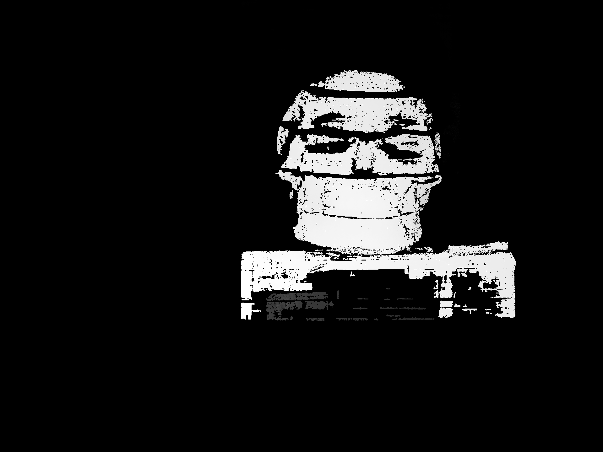

# 本次结构光重建

重复拍摄编号2、11已移到原会话的 excluded_duplicates；其余28对按PPT顺序使用。

从两个方向的5位格雷码差分及四步相移提取时序描述子，按当前场景极线约束寻找对应，过滤不可靠小块后逐有效像素三角化，没有通过插值增加点数。

处理尺寸 (1920, 1440)，场景点 278654，头骨图像ROI内 194438。

- final.ply：场景及双相机。
- colored_cloud.ply：场景彩色点云。
- skull_cloud.ply：左图头骨包围框对应的点云，边缘可能含背景，并非精确物体分割。
- depth.npy：原始深度，无效为NaN。depth.png：灰度显示，近亮远暗。

## 几何与尺度限制

旧标定与本次画面存在明显极线残差，故保留旧内参，并从本次图案互补均值图估计相机R/T方向。场景姿态内点 70，校正后竖直残差中位数 0.679px。基线长度沿用旧标定，只有基线未改变时尺度才成立；单位是棋盘格边长，不能称为毫米精度测量。建议重新采集同一固定装置的双目标定以验证三维形状。

当前删去了格雷码高位，仅保留bit6到bit2，编码存在周期歧义，横竖联合和几何约束能够减少歧义，但不能保证全部匹配正确。阴影、反光与低调制度区域仍有空洞。

## ??????

????????1920?1440???/??40?????????SGBM???????6????????????????3?????????6?????????x/y??????????

????ROI??111534???194438??????ROI?????? 1.48% ?? 56.91%?

??????????????????????????????????????????????????????????
